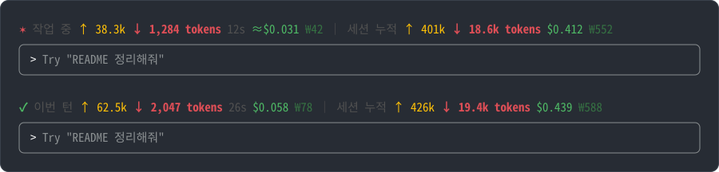
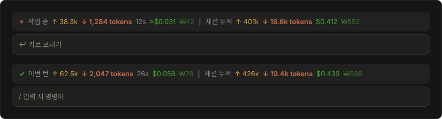

# token-meter

Claude Code 프롬프트 바로 위에 이번 턴과 세션 전체의 토큰 수와 비용(USD·KRW)을 실시간으로 보여주는 플러그인이다. `/cost`를 따로 입력하지 않아도 지금 작업에 토큰과 비용이 얼마나 드는지 바로 알 수 있다.

**터미널** (`dark-ansi` 테마)



**데스크탑 앱 Code 탭**



위는 작업 중, 아래는 턴이 끝난 뒤 모습이다. 토큰 수는 입력과 출력을 더한 값이다. 이번 턴의 토큰 수는 주황, 세션 누적의 토큰 수는 빨강이고, 터미널과 데스크탑 앱에서 같은 색으로 보인다.

## 주요 기능

- 이번 턴의 토큰(입력과 출력의 합), 경과 시간, 비용을 작업하는 동안 실시간으로 보여준다.
- 세션 전체의 토큰과 비용을 함께 보여준다.
- 비용을 달러와 원화로 함께 보여준다. 원화는 그날 환율로 계산한다.
- 서브에이전트가 쓴 토큰과 비용도 포함한다.
- 터미널과 데스크탑 앱 Code 탭(로컬 세션)에서 모두 동작한다.

## 요구 사항

- Claude Code 2.1.286 이상. 데스크탑 앱은 앱 안에 든 Claude Code 버전을 쓰므로 Code 탭에서 `/status`로 확인한다.
- 클라우드 세션과 WSL 세션에서는 동작하지 않는다.

## 설치하기

### 명령어로 설치

터미널(macOS·Linux 셸, Windows PowerShell)에서 다음 두 명령을 차례로 실행한다.

```bash
claude plugin marketplace add dasom222g/claude-token-meter
claude plugin install token-meter@dasom222g --scope user
```

Claude Code 세션 안에서는 다음 한 줄로 설치한다.

```text
/plugin install token-meter --marketplace dasom222g/claude-token-meter
```

사용자 범위(`--scope user`)로 설치하면 모든 폴더의 세션에서 동작한다.

### Claude에게 설치 요청

Claude Code(터미널이나 데스크탑 앱 Code 탭)에 다음과 같이 요청한다. Claude가 아래 [설치 절차](#설치-절차)를 따라 설치한다.

```text
https://github.com/dasom222g/claude-token-meter 플러그인 설치해줘
```

### 설치 절차

Claude가 이 플러그인을 설치해 달라는 요청을 받았을 때 따르는 순서다. 모두 셸 명령이다.

1. `claude --version`으로 Claude Code가 설치돼 있는지 확인한다. 없으면 설치를 멈추고 사용자에게 [Claude Code 설치 문서](https://code.claude.com/docs/en/setup)를 안내한다.
2. 마켓플레이스를 추가한다. 이미 추가돼 있다는 오류가 나오면 무시하고 다음 단계로 넘어간다.
   ```bash
   claude plugin marketplace add dasom222g/claude-token-meter
   ```
3. 사용자 범위로 설치한다. 이미 설치돼 있으면 `claude plugin update token-meter@dasom222g`로 최신 버전을 받는다.
   ```bash
   claude plugin install token-meter@dasom222g --scope user
   ```
   설치 끝에 `userConfig option not yet set` 안내가 나와도 그대로 둔다. 설정하지 않으면 그날 환율을 자동으로 받는다.
4. `claude plugin list`에서 `token-meter@dasom222g`가 `enabled`인지 확인한다.
5. 사용자에게 [사용하기](#사용하기)의 1번을 안내한다. 슬래시 명령은 Claude가 대신 실행할 수 없으므로 사용자가 직접 입력해야 한다.

## 사용하기

설치하면 별도 명령어 없이 바로 동작한다.

1. 설치한 뒤 새로운 세션을 연다. 설치할 때 쓰던 세션에서 바로 확인하려면 그 세션에서 `/reload-plugins`를 한 번 실행한다.
2. 평소처럼 Claude에게 요청하면 프롬프트 바로 위에 표시줄이 나타나고, 답변하는 동안 숫자가 올라간다.
3. 이후 새로운 세션에서는 처음부터 표시줄이 나타난다.

세션 누적을 0부터 다시 세려면 `/clear`를 실행한다.

### 표시 항목

| 항목 | 의미 |
| :- | :- |
| ↓ tokens | 이번 턴의 토큰 수. 입력(캐시 없이 읽은 토큰, 캐시에서 읽은 토큰, 캐시에 쓴 토큰)과 Claude가 생성한 출력을 더한 값이다. 입력은 요청이 끝날 때 API가 알려 주므로 그때 한꺼번에 더해지고, 출력은 작업 중에는 스트리밍되는 글자 수로 추정해 올라가다가 요청이 끝날 때마다 API가 보고한 실제 값으로 맞춘다. |
| 경과 시간 | 이번 턴이 시작된 뒤 흐른 시간 |
| $ · ₩ | API 정가로 환산한 비용. 입력, 캐시 읽기, 캐시 쓰기, 출력을 모두 포함한다. |
| 세션 누적 | 이 세션 전체의 토큰(입력과 출력의 합)과 비용. `/clear`로 초기화된다. |

- `≈`는 추정치라는 뜻이다. 작업 중 비용에 붙고, Esc로 중간에 멈춘 턴에도 붙는다. 중간에 멈추면 API가 실제 값을 보내지 않으므로 그때까지의 추정치를 남긴다.
- 턴이 끝난 표시는 다음 턴이 시작될 때까지 남는다.
- 비용은 Claude Code의 `/cost`와 같은 값을 쓴다. 구독 요금제에서는 실제 청구액이 아니라 API로 사용했을 때의 환산 금액이다.
- 토큰 수의 대부분은 캐시에서 읽은 입력이다. 캐시 읽기는 1토큰 값이 출력의 수십 분의 1이라, 토큰 수가 커도 비용은 그만큼 크지 않다.
- Esc로 중간에 멈춘 요청은 API가 사용량을 보내지 않으므로 그 요청의 입력 토큰은 세지 않고, 스트리밍된 출력만 추정치로 남는다.
- 생각(thinking) 중에는 내용이 스트리밍되지 않아 토큰 수가 멈추고 시간만 올라간다. 요청이 끝나면 생각 토큰까지 포함한 실제 값으로 반영된다.
- `/resume`으로 재개한 세션은 비용은 처음부터 이어서 세고, 토큰 수는 재개한 시점부터 센다.
- 터미널에서는 Claude Code 기본 스피너와 이 표시줄이 함께 보인다.

### 환율 설정

기본값(`0`)이면 그날 환율을 받아 12시간 동안 재사용하고, 받지 못하면 1달러에 1,400원으로 계산한다. 고정 환율을 쓰려면 Claude Code에서 다음 명령을 실행하고 `KRW per USD` 값을 입력한다.

```text
/plugin configure token-meter@dasom222g
```

### 색

이번 턴의 토큰 수는 주황(`#D77757`), 세션 누적의 토큰 수는 빨강(`#DD4E56`)으로 표시하고, ₩ 금액은 흐린 초록(`#357142`)으로 표시한다. `dark`·`dark-ansi` 테마는 터미널과 데스크탑 앱 모두 같은 값(초록 `#4EBA65`, 회색 `#505050`)으로 고정해 두 화면이 같게 보인다. `light` 테마는 이번 턴의 토큰 수를 `#D77757`, 세션 누적의 토큰 수를 `#C4313A`, ₩ 금액을 `#8BB692`로 고정하고 나머지는 테마 색을 쓴다. 그 밖의 테마(daltonized, light-ansi, 사용자 정의)는 테마 색을 그대로 쓰므로 화면마다 조금 다르게 보일 수 있다.

## 업데이트

새 버전은 다음 명령으로 받는다. 이 마켓플레이스의 자동 업데이트는 기본으로 꺼져 있다.

```bash
claude plugin update token-meter@dasom222g
```

업데이트한 뒤에는 새로운 세션을 열거나 `/reload-plugins`를 실행한다.

## 제거

### 명령어로 제거

터미널에서 다음 두 명령을 차례로 실행한다.

```bash
claude plugin uninstall token-meter@dasom222g
claude plugin marketplace remove dasom222g
```

제거한 뒤에는 새로운 세션을 열거나 `/reload-plugins`를 실행한다.

### Claude에게 제거 요청

Claude Code에 다음과 같이 요청한다.

```text
token-meter 플러그인 제거해줘
```

Claude는 위 두 명령을 차례로 실행하고, `claude plugin list`에서 `token-meter@dasom222g`가 사라졌는지 확인한 뒤, 사용자에게 새로운 세션을 열거나 `/reload-plugins`를 직접 실행하라고 안내한다.

## 데이터와 네트워크

이 플러그인이 읽고, 보내고, 저장하는 것은 다음이 전부다.

- **읽는 것**: Claude Code가 세션 안에서 제공하는 토큰 사용량과 비용, Claude Code 테마 설정. 스트리밍되는 답변은 토큰 수를 추정하는 데만 쓰고 저장하거나 보내지 않는다.
- **보내는 것**: 환율을 받으려고 [open.er-api.com](https://open.er-api.com/v6/latest/USD)에 요청을 보낸다. 12시간에 한 번 이하이고, 고정 환율을 설정하면 보내지 않는다. 요청에는 사용자 정보가 들어가지 않는다.
- **저장하는 것**: 받아 온 환율과 받은 시각을 Claude Code 플러그인 저장소에 저장한다.

## 문제 해결

- **표시줄이 나타나지 않는다**: 새로운 세션을 열거나 `/reload-plugins`를 실행한다. `claude plugin list`에서 `token-meter@dasom222g`가 `enabled`인지 확인한다.
- **데스크탑 앱에서만 나타나지 않는다**: Code 탭에서 `/status`로 Claude Code 버전이 2.1.286 이상인지 확인한다.
- **`/clear` 후에도 세션 누적이 초기화되지 않는다**: 조직이 관리하는 Claude Code에서는 관리 설정에 등록되지 않은 플러그인의 `/clear` 감지가 동작하지 않는다.

그 밖의 문제나 제안은 [GitHub Issues](https://github.com/dasom222g/claude-token-meter/issues)에 남긴다.

## 개발

저장소를 내려받은 뒤 다음 명령으로 검사하고 실행한다.

```bash
claude plugin validate --strict .   # 매니페스트와 훅 검사
claude plugin test .                # 테스트 실행
claude --plugin-dir .               # 이 폴더의 플러그인을 불러와 Claude Code 실행
```

## 라이선스

[MIT](LICENSE) © dasom222g
