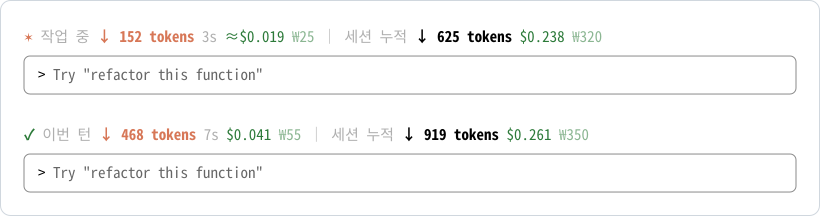

# token-meter

Claude Code 프롬프트 바로 위에 이번 턴과 세션 전체의 출력 토큰, 비용(USD·KRW)을 보여주는 표시줄 플러그인.

<picture>
  <source media="(prefers-color-scheme: dark)" srcset="docs/preview-dark.svg">
  
</picture>

터미널에서 본 모습이다(위: 작업 중, 아래: 턴이 끝난 뒤). 색은 Claude Code 테마와 터미널 설정에 따라 조금 다를 수 있다. 터미널에서는 늘 보인다. 데스크탑 앱 Code 탭(로컬 세션)에서는 앱이 작업 중에만 이 자리를 그려서, 턴이 끝나면 사라진다.

## 설치

### Claude에게 맡기기

Claude Code(터미널이나 데스크탑 앱 Code 탭)에 이렇게 말한다.

```text
https://github.com/dasom222g/claude-token-meter 플러그인 설치해줘
```

Claude가 아래 [설치 절차](#설치-절차)를 따라 설치한다. 끝나면 새 세션을 열거나 `/reload-plugins`를 실행한다.

### 직접 설치

터미널(macOS·Linux 셸, Windows PowerShell 모두 같다)에서:

```bash
claude plugin marketplace add dasom222g/claude-token-meter
claude plugin install token-meter@dasom222g --scope user
```

Claude Code 세션 안에서는:

```text
/plugin marketplace add dasom222g/claude-token-meter
/plugin install token-meter@dasom222g
```

설치 후 새 세션을 열거나 `/reload-plugins`를 실행하면 표시줄이 나타난다. 사용자 범위(`--scope user`)로 설치하면 모든 폴더의 세션과 데스크탑 앱 Code 탭 로컬 세션에서 로드된다.

### 설치 절차

Claude가 이 플러그인을 설치해 달라는 요청을 받았을 때 따르는 순서다. 모두 셸 명령이다.

1. `claude --version`으로 Claude Code가 있는지 확인한다. 없으면 설치를 멈추고 사용자에게 [Claude Code 설치](https://code.claude.com/docs/en/setup)를 안내한다.
2. 마켓플레이스를 추가한다. 이미 추가돼 있다는 오류는 무시하고 다음으로 넘어간다.
   ```bash
   claude plugin marketplace add dasom222g/claude-token-meter
   ```
3. 사용자 범위로 설치한다. 이미 설치돼 있으면 `claude plugin marketplace update dasom222g`와 `claude plugin update token-meter@dasom222g`로 최신 버전을 받는다.
   ```bash
   claude plugin install token-meter@dasom222g --scope user
   ```
   설치 끝에 `userConfig option not yet set` 안내가 나와도 그대로 둔다. 설정하지 않으면 그날 환율을 자동으로 받는다.
4. `claude plugin list`에서 `token-meter@dasom222g`가 `enabled`인지 확인한다.
5. 사용자에게 알린다: 지금 세션에 반영하려면 `/reload-plugins`를 직접 입력하거나 새 세션을 열어야 한다(슬래시 명령은 Claude가 대신 실행할 수 없다). 고정 환율을 원하면 `/plugin configure token-meter@dasom222g`로 설정한다.

### 요구 사항

- Claude Code 2.1.286 이상. 데스크탑 앱은 앱 안에 든 Claude Code 버전을 쓰므로 Code 탭에서 `/status`로 확인한다.
- 조직이 관리하는 Claude Code에서는 관리 설정에 등록되지 않은 플러그인의 `/clear` 감지가 동작하지 않아, `/clear` 후에도 세션 누적이 초기화되지 않을 수 있다.
- 클라우드 세션과 WSL 세션에는 로드되지 않는다.

## 표시 내용

| 항목 | 의미 |
| :- | :- |
| 이번 턴 ↓ tokens | 이번 턴에 Claude가 생성한 출력 토큰. 작업 중에는 스트리밍 글자 수로 추정해 계속 올라가고, 요청이 끝날 때마다 API가 보고한 실제 값으로 맞춘다. Esc로 중간에 멈추면 실제 값이 오지 않으므로 그때까지의 추정치를 `≈`와 함께 남긴다. 턴이 끝나도 다음 턴이 시작될 때까지 남는다. |
| 경과 시간 | 이번 턴이 시작된 뒤 흐른 시간 |
| $ · ₩ | API 정가로 환산한 비용. 입력·캐시 읽기·캐시 쓰기·출력을 모두 포함한다. `≈`는 아직 스트리밍 중인 출력이 추정치라는 뜻이다. |
| 세션 누적 | 이 세션 전체의 출력 토큰과 비용. `/clear`로 초기화된다. |

- 비용은 Claude Code의 `/cost`와 같은 장부(`$.session.usage().cost`)를 쓴다. 구독 요금제에서는 실제 청구액이 아니라 API로 썼을 때의 환산 금액이다.
- 생각(thinking) 중에는 내용이 스트리밍되지 않아 토큰 수가 멈추고 시간만 올라간다. 요청이 끝나면 생각 토큰까지 포함한 실제 값으로 반영된다.
- 서브에이전트가 쓴 토큰과 비용도 이번 턴과 세션 누적에 포함된다.
- `/resume`으로 재개한 세션은 비용만 처음 시작부터 이어지고, 토큰 수는 재개한 시점부터 센다.
- `dark-ansi` 테마에서는 터미널 팔레트가 초록과 회색까지 바꿔 버려서, 터미널에 그릴 때만 기본 다크 테마의 초록(`#4EBA65`)과 회색(`#505050`)으로 고정한다. 주황 강조색은 터미널 팔레트를 따른다.
- 터미널에서는 Claude Code 기본 스피너(`Spinning… (8s · ↓ 638 tokens)`)와 이 표시줄이 함께 보인다.

## 환율

기본값 `0`이면 하루 환율을 [open.er-api.com](https://open.er-api.com/v6/latest/USD)에서 받아 12시간 동안 재사용한다. 받지 못하면 1,400원으로 계산한다. 고정 환율을 쓰려면 Claude Code에서 다음을 실행한다.

```text
/plugin configure token-meter@dasom222g
```

## 네트워크와 데이터

환율을 받으려고 [open.er-api.com](https://open.er-api.com/v6/latest/USD)에 요청을 보낸다(12시간에 한 번 이하, 고정 환율을 설정하면 보내지 않는다). 그 밖에는 어디에도 데이터를 보내지 않는다. 환율 캐시는 Claude Code 플러그인 저장소에만 남는다.

## 제거

```bash
claude plugin uninstall token-meter@dasom222g
claude plugin marketplace remove dasom222g
```

## 개발

```bash
claude plugin validate .
claude plugin test .
claude --plugin-dir .
```
